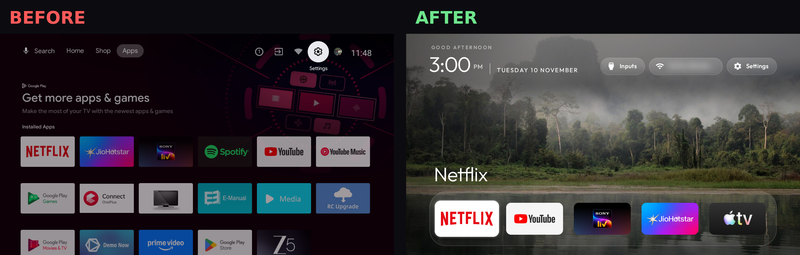
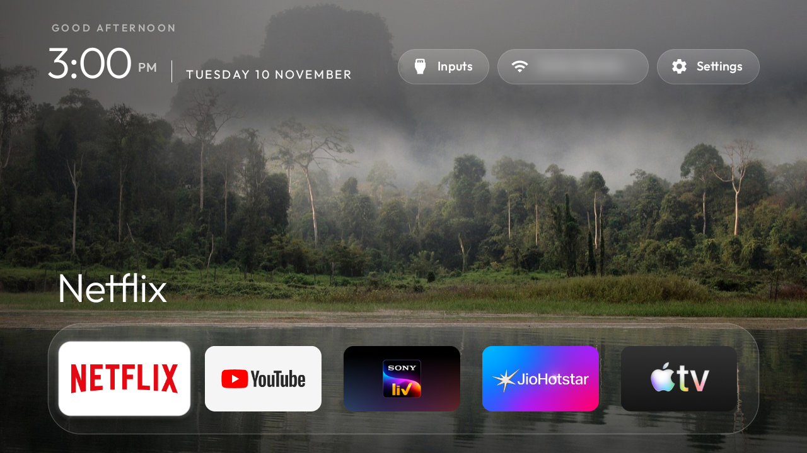
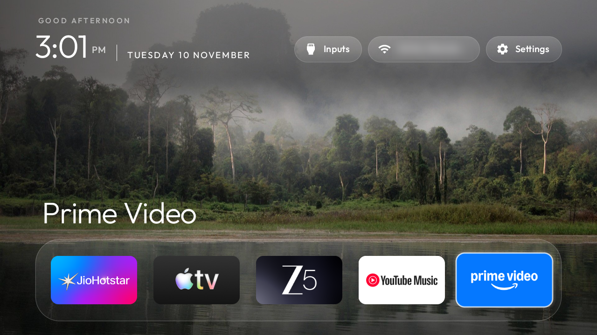
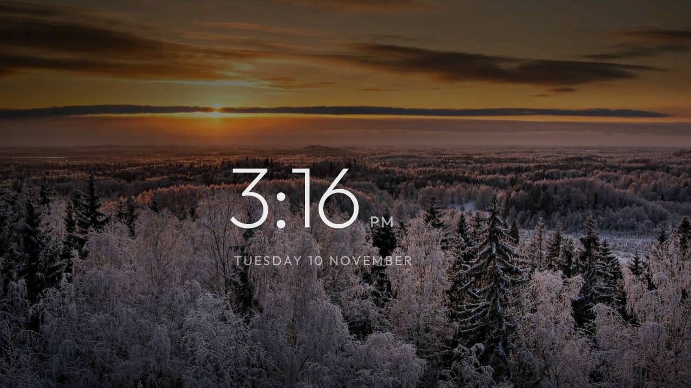
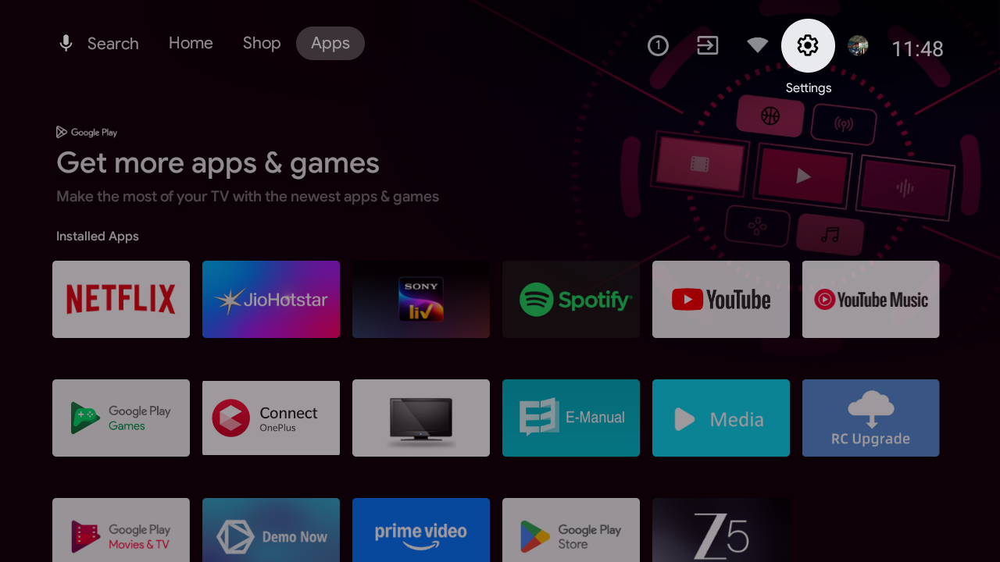

# 📺 OnePlus TV Glow-up: Android TV → Apple TV-style, with AI

My OnePlus Y1 43" Android TV was slow, full of ads and preloaded junk. It made me miss a Manchester United goal.
So I spent one evening turning it into a clean, Apple TV-style home screen, using **Claude Code** as my
engineer and the open-source **[CleanYourTV](https://github.com/Gathin23/cleanyourtv)** project as the foundation.



> No root. No cable. Nothing uninstalled. Everything is reversible with one script.

---

## 🧩 The problem

| Pain | What it felt like |
|---|---|
| Slow start-up | The TV opened Live TV first, then a heavy home screen loaded |
| Ads everywhere | "Get more apps & games" banners and sponsored rows |
| Bloat | Retail demos, a factory test suite, an e-manual, tracking services, apps I never used |

## 🛠️ What I did

| Step | Detail |
|---|---|
| **Research** | Found CleanYourTV via a YouTube walkthrough; the repo already had a tested list for my exact TV (`examples/oneplus-tv-y1`) |
| **Setup (Mac, Apple Silicon)** | Homebrew, ADB, OpenJDK 17, Android SDK 34, Claude Code. Notes on the snags I hit are in [SETUP-NOTES.md](SETUP-NOTES.md) |
| **Backup** | Full package list, settings and device properties saved before touching anything |
| **Debloat in 3 batches** | 17 packages *disabled* (not deleted), with a screenshot check after each batch. See [`debloat/`](debloat) |
| **New launcher** | Built from source and installed as Home; stock launcher disabled only after the new one was verified |
| **Product decisions (mine)** | Which apps stay, dock order, keep Chromecast + Assistant, boot to Home not Live TV, a PS5 shortcut button |
| **Polish** | Nature scenery theme, legible text over photos, clock screensaver, tuned picture settings |

### Debloat batches

| Batch | What | Count |
|---|---|---|
| [1: demos & telemetry](debloat/batch1-demo-telemetry.txt) | Skyworth auto-installs, retail demos, disclaimer splash, e-manual, feedback agent, calendar sync, boot splash, recommendation/ad rows, partner customizer | 11 |
| [2: factory tools](debloat/batch2-factory.txt) | Coocaa factory suite, MediaTek picture & factory test tools | 3 |
| [3: my choice](debloat/batch3-user-choice.txt) | Remote OTA updater, Play Games, Play Movies & TV | 3 |

**Kept on purpose:** Netflix, Prime Video, JioHotstar, Sony LIV, ZEE5, Spotify, YouTube, YouTube Music,
Google Assistant, Chromecast, Play Store, Live TV + HDMI, OnePlus Connect remote, keyboard.

### Customisations

| Feature | How |
|---|---|
| Dock | Netflix · YouTube · Sony LIV · JioHotstar · Apple TV, in a frosted-glass band |
| Power-on | Opens the new Home instead of Live TV (`power_on_home` + Home-key helper) |
| Wallpaper | 12 nature photos (Wikimedia Commons, [credits](theme/CREDITS.md)), shuffled every 5 min, with a per-photo gradient so white text stays readable |
| Clock screensaver | After 3 idle minutes, or press Back on Home |
| PS5 button | The remote's Menu button jumps straight to HDMI 1 |
| Ad-blocking DNS | Private DNS set to AdGuard (blocks many ad/tracker domains) |
| Theme file | [`theme/config.json`](theme/config.json) |

## 📊 Results

| | Before | After |
|---|---|---|
| Home screen | Stock Android TV with banners and sponsored rows | Apple TV-style dock over scenery |
| Ads on Home | Yes | 0 |
| Bloat packages running | 17 | 0 (disabled) |
| Power-on lands on | Live TV | Home |
| Launcher size | Stock Google launcher | ~572 KB |
| Time spent | | One evening, including debugging |
| Still working | | Live TV, HDMI, voice remote, Chromecast, all streaming apps |

| | |
|---|---|
|  |  |
| *Home: the dock over a rotating scenery photo* | *Scrolling the single-row dock* |
|  |  |
| *Clock screensaver* | *Before: the stock home screen* |

## 🔁 Reproduce it (or undo it)

These files sit on top of a CleanYourTV clone:

```bash
git clone https://github.com/Gathin23/cleanyourtv && cd cleanyourtv
mkdir -p work && cp /path/to/this-repo/debloat/*.txt /path/to/this-repo/scripts/*.sh work/
```

Then open the folder in Claude Code and paste the project's [PROMPT.md](https://github.com/Gathin23/cleanyourtv/blob/main/PROMPT.md)
with your TV model. For a OnePlus Y1 43", point it at `examples/oneplus-tv-y1/debloat.txt`.

**Undo everything** (with ADB on and the TV connected):

```bash
work/restore-all.sh <tv-ip>                    # re-enables all 17 packages + stock launcher, resets DNS
REMOVE_LAUNCHER=1 work/restore-all.sh <tv-ip>  # also uninstalls the new launcher
```

## 💡 What I learned as a PM

- **AI is the hands, I'm the brain.** Claude Code ran every command; I owned every decision that affected how I use the TV.
- **Reversibility is a feature.** Backup first, disable instead of delete, small batches with a check after each one.
- **Don't build what's already validated.** A tested list for my exact model saved hours and removed most of the risk.
- **Debugging is the job.** A broken Homebrew download, Java hidden from the PATH, macOS network permissions: each one was a 5-minute fix once read carefully.

## 🙏 Credits

- [CleanYourTV](https://github.com/Gathin23/cleanyourtv) by Gathin23 (MIT): the launcher, scripts and the tested OnePlus Y1 list
- [Techy Pathshala](https://www.youtube.com/watch?v=rGG3xbmkbCI) for the video that started it
- Wallpaper photographers on Wikimedia Commons: see [theme/CREDITS.md](theme/CREDITS.md)
- Built with [Claude Code](https://claude.com/claude-code)

⚠️ Do this at your own risk. It worked on my TV (Android TV 11, firmware `RTO9.231122.002`); yours may differ.
